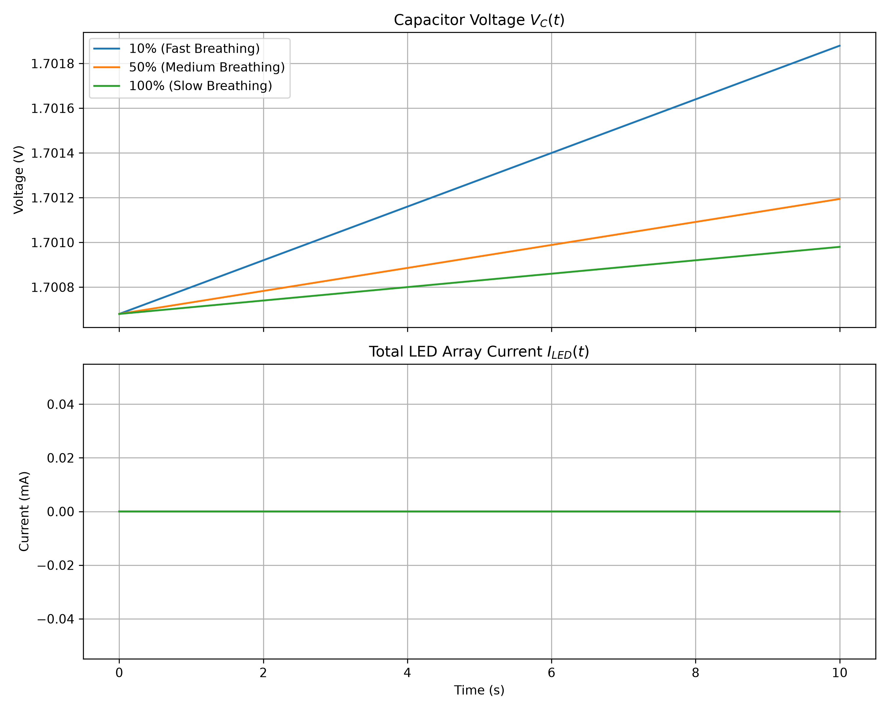

A cute heart shaped breathing LED kit that will help you improving your soldering skill. And it's a cute gift for your partners.
# HBL-22 Heart-Shaped Breathing LED Kit — Hardware & Circuit Analysis

## 1. Project Overview
This repository documents the hardware assembly, Bill of Materials (BOM), and analog circuit analysis of the **HBL-22 (Rev 1.0)** heart-shaped breathing LED module. Instead of using a microcontroller (PWM), this circuit generates a smooth triangular/exponential "breathing" light wave purely through analog signal processing using an **LM358 Dual Operational Amplifier** and an **S8050 NPN Bipolar Junction Transistor (BJT)**.

* **Operating Voltage:** 4V – 6V DC (USB 5V or 3×AA 1.5V batteries)
* **PCB Dimensions:** 50.7 mm × 50.7 mm
* **Active Controller:** LM358 Dual Op-Amp (DIP-8)

---

## 2. Bill of Materials (BOM)

| Designator | Component Name | Value / Part Number | Qty | Role in Circuit |
| :--- | :--- | :--- | :---: | :--- |
| **U1** | Dual Operational Amplifier | LM358 (DIP-8) | 1 | Square-wave comparator (U1A) & RC integrator (U1B) |
| **Q1** | NPN Transistor (BJT) | S8050 (TO-92) | 1 | Emitter-follower current driver for the 22 LEDs |
| **R1, R2, R4** | Carbon Film Resistor | 47 kΩ | 3 | Virtual ground voltage divider ($V_{CC}/2$) & hysteresis feedback |
| **R3** | Carbon Film Resistor | 100 kΩ | 1 | Positive feedback hysteresis resistor |
| **R5** | Carbon Film Resistor | 22 Ω | 1 | Current-limiting resistor for the LED array |
| **R6** | Carbon Film Resistor | 10 kΩ | 1 | Base current limiting / discharge path |
| **VR1** | Rotary Potentiometer | B50 kΩ | 1 | Adjusts RC charge/discharge time constant (breathing speed) |
| **C1** | Electrolytic Capacitor | 47 µF | 1 | Integrator timing capacitor |
| **LED1 – LED22** | 5mm Diffused LED | Red / Blue / Green | 22 | Parallel heart-shaped indicator array |
| **S1** | Push-Button Switch | Self-locking | 1 | Main power switch |

---

## 3. Analog Circuit Working Principle

The HBL-22 operates as a classic **two-stage analog function generator** driving a high-current transistor buffer:

### Stage 1: Reference Voltage Divider ($R_1, R_2$)
Because the circuit runs on a single DC supply ($V_{CC} = 5\text{V}$) rather than a dual $\pm$ supply, resistors $R_1$ ($47\text{ k}\Omega$) and $R_2$ ($47\text{ k}\Omega$) form a symmetric voltage divider to bias the op-amp's non-inverting reference at mid-rail:
$$V_{\text{ref}} = V_{CC} \cdot \frac{R_2}{R_1 + R_2} = 0.5\,V_{CC}$$

### Stage 2: Schmitt Trigger & RC Integrator ($U_{1A}, U_{1B}, VR_1, C_1$)
1. **Comparator with Hysteresis:** One half of the LM358 acts as a Schmitt trigger (comparator with positive feedback via $R_3 = 100\text{ k}\Omega$ and $R_4 = 47\text{ k}\Omega$). Its output switches between logic HIGH ($\approx V_{CC} - 1.5\text{V}$) and logic LOW ($\approx 0\text{V}$).
2. **RC Triangle/Exponential Ramp:** The second half of the LM358, paired with the $50\text{ k}\Omega$ potentiometer ($VR_1$) and the $47\text{ }\mu\text{F}$ electrolytic capacitor ($C_1$), integrates the square wave into a slowly rising and falling voltage ramp.
3. **Breathing Frequency Control:** Turning potentiometer $VR_1$ changes the effective resistance $R_{\text{eff}}$ charging $C_1$, which directly varies the time constant:
$$\tau = R_{\text{eff}} \cdot C_1$$
   * **Minimum $\tau$ ($VR_1 \to 0\text{ }\Omega$):** Fast breathing pulse ($\tau \approx 10\text{ k}\Omega \times 47\text{ }\mu\text{F} \approx 0.47\text{ s}$).
   * **Maximum $\tau$ ($VR_1 \to 50\text{ k}\Omega$):** Slow, deep breathing cycle ($\tau \approx 60\text{ k}\Omega \times 47\text{ }\mu\text{F} \approx 2.82\text{ s}$).

### Stage 3: S8050 Current Buffer ($Q_1, R_5$)
The LM358 op-amp output can only source ~20–40 mA, which is not enough to drive 22 LEDs simultaneously. The op-amp output feeds the base of the **S8050 NPN transistor ($Q_1$)**, which amplifies the current ($\beta \approx 100\text{–}300$) and smoothly modulates the voltage across the 22 parallel LEDs and the $22\text{ }\Omega$ current-limiting resistor ($R_5$).

---

## 4. Circuit Simulation & Waveforms

The breathing behavior has been simulated using a Python script, computing the exponential rise/fall of the integration capacitor $V_C(t)$ and the proportional LED current $I_{LED}(t)$ based on the LM358 and S8050 configuration.



### Running the Simulation
To generate the waveform plot, ensure you have Python 3 installed along with `numpy` and `matplotlib`:

```bash
pip install numpy matplotlib
python simulate_rc_breathing.py
```

---

## 5. Repository Structure
* `/20180110030354HBL-22-heart-shaped-breathing-LED-kit-.pdf` — Original schematic, PCB layout, and component assembly sheet.
* `/photos` — *(Upcoming)* High-resolution macro inspection of THT solder joints and assembled PCB.
  * 
  * 
* `/cad` — *(Upcoming)* 2D TCVN orthographic projection (`ME2011`) & 3D enclosure model for the 50.7 × 50.7 mm PCB.
